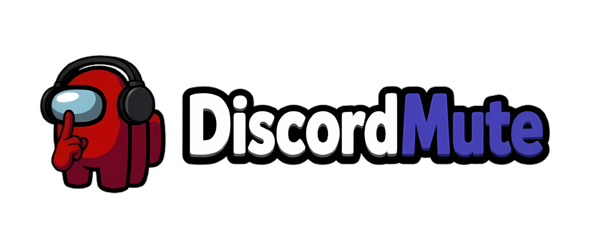

<div align="center">
  

  <p><strong>Automatic Discord voice muting for Among Us.</strong></p>

  <p>
    
    
    
    
    
    
  </p>
</div>

<br />

DiscordMute mutes and unmutes players in Discord in step with the Among Us round state. It also supports the EHR Blackmailer, so blackmailed players stay muted during meetings.

I built it because my friend group kept talking during live rounds and didn't want to mute themselves every game. It has two parts: an Among Us plugin (`DLL`) and a Discord bot (`DiscordBot`).

## Quick start

1. Install the 64-bit BepInEx build into your Among Us folder and copy `DiscordMute.dll` into `BepInEx/plugins`.
2. Start Among Us once, then set `ip`, `secret` and `exe` in the `config.json` created in `BepInEx/DiscordMute`.
3. In `DiscordBot`, rename `config.example.json` to `config.json` and fill in `token`, `clientId`, `guildId` and the same `secret`.
4. Host a lobby (online or LAN), join a Discord voice channel and run `/link self`.
5. Send the phrase the bot gives you in Among Us Free Chat.

The full walkthrough is in [self-host setup guide](https://docs.mute.yonn2222.com/getting-started/self-host-setup).

Prefer not to run a bot? With the hosted bot you add it to your server, create a secret with `/setup` and set `"mode": "hosted"` and your `secret` in the plugin config. See [hosted setup](https://docs.mute.yonn2222.com/getting-started/hosted-setup).

## Documentation

The website is [mute.yonn2222.com](https://mute.yonn2222.com) (source in `Website/`, see [Website/README.md](Website/README.md)). The documentation lives at [docs.mute.yonn2222.com](https://docs.mute.yonn2222.com) (source in `docs/`, see [docs/README.md](docs/README.md)).

- [Self-host setup](https://docs.mute.yonn2222.com/getting-started/self-host-setup)
- [Hosted setup](https://docs.mute.yonn2222.com/getting-started/hosted-setup)
- [Bot configuration](https://docs.mute.yonn2222.com/configuration/bot-config) and [plugin configuration](https://docs.mute.yonn2222.com/configuration/plugin-config)
- [Commands](https://docs.mute.yonn2222.com/commands/slash-commands)
- [Metrics](https://docs.mute.yonn2222.com/monitoring/metrics) and [JSON logs](https://docs.mute.yonn2222.com/monitoring/json-logs)
- [Telemetry](https://docs.mute.yonn2222.com/privacy/telemetry) and [update check](https://docs.mute.yonn2222.com/privacy/update-check)
- [Server setup](https://docs.mute.yonn2222.com/server-setup/setup-panel) and [game features](https://docs.mute.yonn2222.com/server-setup/game-features)
- [FAQ](https://docs.mute.yonn2222.com/faq/faq)

## Linking players

DiscordMute has to know which Discord user is which Among Us player.

1. Run `/link self` in Discord. The bot replies with a one-time phrase such as `link-AB12`.
2. Send that phrase exactly in Free Chat in an Among Us lobby.
3. The plugin catches it before it shows up in chat and sends your Among Us name to the bot, which links the account and confirms in-game.

Phrases expire after 5 minutes. Links are stored in `DiscordBot/data/linking.sqlite`. If a player changes their Among Us name, they run `/link self` again or an admin uses `/link force`.

| Command                         | Purpose                                                                  |
|---------------------------------|--------------------------------------------------------------------------|
| `/link self`                    | Link your own account.                                                   |
| `/link force user display-name` | Link a Discord user to an Among Us name (admin).                         |
| `/link reset [user]`            | Unlink your account, or another user's (requires Manage Server).         |
| `/testconnection`               | Check that the bot can reach the plugin.                                 |
| `/setup`                        | Open the private settings panel for the server (requires Manage Server). |

## Host mods

- Town Of Host Enhanced and Endless Host Roles improve player-name resolution.
- Endless Host Roles also enables Blackmailer support: a silenced player is treated like a dead player for the voice sync and stays muted in the meeting.

Without these mods DiscordMute works normally, minus the Blackmailer support.

## Features

- Automatic mute sync with the round state
- EHR Blackmailer support
- Self-service linking through Free Chat, or Quick Chat phrases when Free Chat is unavailable
- Crash-safe mutes: after a crash or restart the bot unmutes the players it muted, and only those
- Optional forwarding of plugin and BepInEx logs to the bot console

## Server setup

Admins with Manage Server configure the bot per server with `/setup`:

- log channel for plugin, game, link and settings events
- self-updating link overview with Link/Unlink buttons
- live status message (phase, players, spoiler lobby code) and a match summary after each game
- voice rules per phase for living and dead players (free, mute, deafen), delays up to 5 seconds, handling of members who are not playing
- optional ghost chat (dead players talk while the living are deafened; it leaks information if a deafen fails)
- nickname sync and automatic relink after an Among Us rename

The bot needs **Mute Members**, **Deafen Members** and **Manage Nicknames**, plus View Channel, Send Messages and Manage Messages in the channels you pick. Its role must sit above your players' roles.

Update the plugin and the bot together. A 2.x plugin still works with a 3.0 bot, without the player list, deaths and match results. A 3.0 plugin still connects to a 2.x bot, but only sends the version 2 messages. Anything older is refused as outdated.

Details: [setup panel](https://docs.mute.yonn2222.com/server-setup/setup-panel), [game features](https://docs.mute.yonn2222.com/server-setup/game-features).

## Telemetry

DiscordMute sends a small anonymous usage packet by default. Please leave it on; it is the only way I can see which versions are in use and where to improve. It is a counter, not a tracker.

Every 5 minutes the bot sends to `mute.yonn2222.com`:

- a random instance id, generated on first start and stored in the bot database
- a random packet id and a schema version
- self-hosted or hosted, and the bot version
- how many plugins run each plugin version and Among Us version
- counts: linked users, active games, servers, connected plugins
- counts since the last packet: games muted, mutes, unmutes, rate limit hits, lobbies, game starts, meeting starts and ends
- average mute latency and its sample count
- per optional feature, the number of servers that enabled it

Never sent: Discord IDs, server, channel or player names, IP addresses, secrets, or hashes of any of these. The server rejects any field beyond the above. The connection reaches the server from your IP address, which is used only for rate limiting at the edge and is not stored with the packet.

Telemetry runs only in the compiled `bot.exe` from a release. From source (`bun run dev`) it is off unless `DISCORDMUTE_TELEMETRY=1` is set. To disable it, add this to the bot `config.json` (the key is intentionally missing from `config.example.json`):

```json
"disableTelemetry": true
```

See [bot configuration](https://docs.mute.yonn2222.com/configuration/bot-config).

## Update check

The bot and plugin request the latest release from the GitHub API (`api.github.com/repos/YONN2222/AmongUs-DiscordMute/releases/latest`). Nothing about you is sent beyond the usual request headers and a `User-Agent` with the DiscordMute version. The bot logs a notice at start and then daily. The plugin checks once per game launch and when you become lobby host, and shows a one-time notice in lobby chat.

Disable it with `"disableUpdateCheck": true` in the bot `config.json` and, separately, in the plugin `config.json`.

<details>
<summary><h2 style="display:inline;">Technical details</h2></summary>

| Component    | Stack                                                                                   |
|--------------|-----------------------------------------------------------------------------------------|
| `DLL`        | C# (.NET 6) + [BepInEx](https://github.com/BepInEx/BepInEx) IL2CPP plugin               |
| `DiscordBot` | [Bun](https://bun.sh/) + TypeScript + [discord.js](https://discord.js.org/) + WebSocket |

The bot runs as a gateway process plus one or more cluster processes. The plugin connects to the gateway over one WebSocket and sends the secret in the handshake, not in URLs. Releases ship the bot as a compiled `bot.exe` (`bun build --compile`), so Bun is not needed to run it.

```text
AmongUs-DiscordMute/
├── DLL/            # C# / BepInEx Among Us plugin
├── DiscordBot/     # Bun + TypeScript Discord bot
├── Website/        # Nuxt website on Cloudflare Workers + D1
├── docs/           # Docus documentation site
├── assets/         # Logos and images
└── update.example.ps1
```

</details>

---

<div align="center">
  <sub>Licensed under <a href="LICENSE">GPLv3</a>.</sub>
</div>
